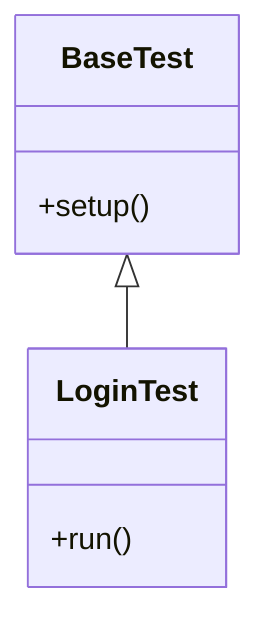
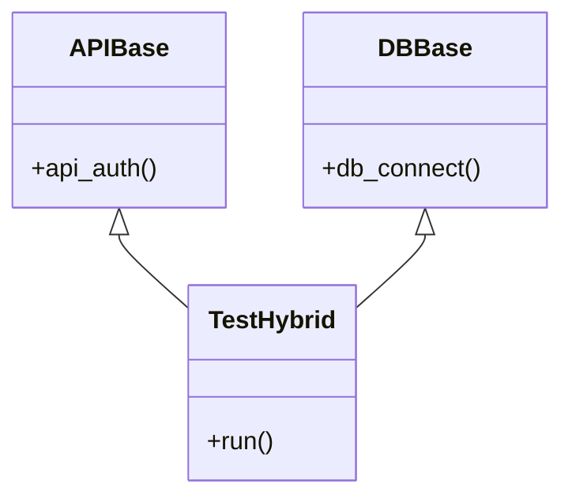
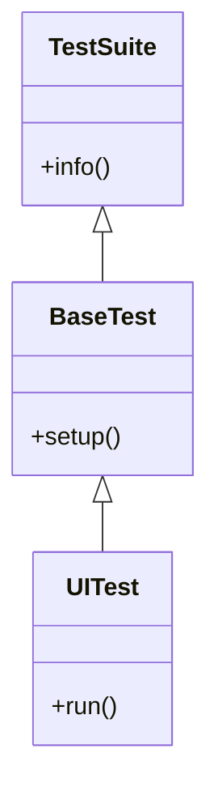
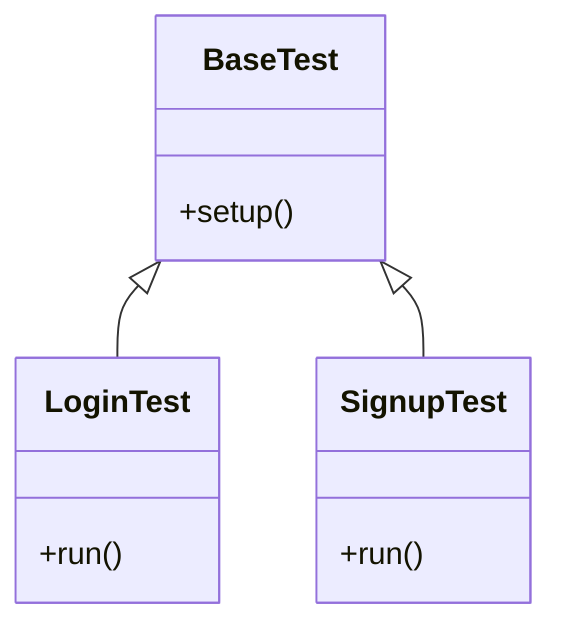
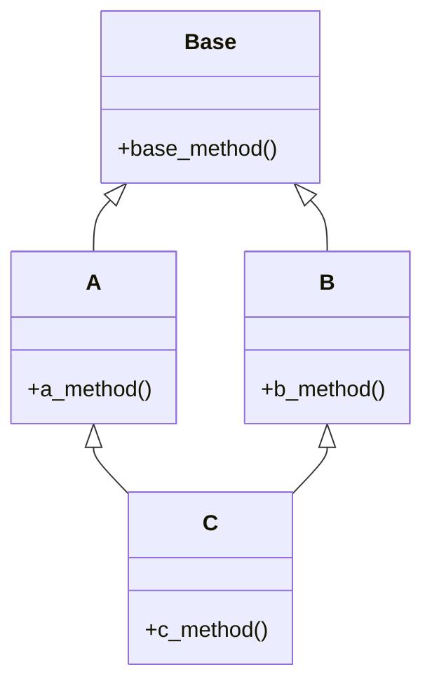

# Inheritance in Python — Complete Guide

## What is Inheritance?

Inheritance is a core OOP concept where a **child class** acquires the properties and methods of a **parent class**. It promotes **code reuse** — you write common logic once in the parent and share it across multiple children.

**Real-world analogy:** A child inherits traits (eyes, height) from parents. The child has those traits automatically without redefining them.

```text
Parent Class (Base)   ──>  Child Class (Derived)
   ↑                          ↑
  General                   Specific
```

---

## Types of Inheritance in Python

Python supports **5 types** of inheritance:

| # | Type | Description | Files |
|---|------|-------------|-------|
| 1 | **Single** | One child inherits from one parent | `143_SI.py` |
| 2 | **Multiple** | One child inherits from multiple parents | `144_MI.py`, `145_MI_002.py` |
| 3 | **Multilevel** | Chain: Grandparent → Parent → Child | `146_ML.py` |
| 4 | **Hierarchical** | One parent, multiple children | `147_HI.py` |
| 5 | **Hybrid** | Mix of multiple + multilevel | `148_Hybrid.py` |

---

## 1. Single Inheritance

**One parent → One child**



```python
class BaseTest:
    def setup(self):
        print("Launching browser")

class LoginTest(BaseTest):   # LoginTest IS-A BaseTest
    def run(self):
        self.setup()         # Inherited method
        print("Running login test")

t = LoginTest()
t.setup()  # From parent
t.run()    # From child
```

**Real-world use:** A base page class → specific page class (LoginPage, HomePage).

---

## 2. Multiple Inheritance

**Multiple parents → One child**



```python
class APIBase:
    def api_auth(self):
        print("Authenticating via API")

class DBBase:
    def db_connect(self):
        print("Connecting to database")

class TestHybrid(APIBase, DBBase):  # Inherits from BOTH
    def run(self):
        self.api_auth()
        self.db_connect()
        print("Running test")

tc = TestHybrid()
tc.run()
```

**⚠️ Diamond Problem & MRO:** If both parents have a method with the same name, Python uses **MRO (Method Resolution Order)** — left-to-right, depth-first.

```python
class Father1:
    def money(self):
        print("Father1's money")

class Father2:
    def money(self):
        print("Father2's money")

class Child(Father2, Father1):  # Father2 checked FIRST
    pass

c = Child()
c.money()  # Output: Father2's money (leftmost parent wins)
print(Child.__mro__)  # See the resolution order
```

**Real-world use:** A test class that needs both API authentication AND database connection.

---

## 3. Multilevel Inheritance

**Grandparent → Parent → Child (chain)**



```python
class TestSuite:          # Grandparent
    def info(self):
        print("Test Suite v2.0")

class BaseTest(TestSuite):  # Parent
    def setup(self):
        print("Setting up browser")

class UITest(BaseTest):     # Child
    def run(self):
        self.info()    # From grandparent
        self.setup()   # From parent
        print("Running UI test")

test = UITest()
test.run()
```

**Real-world use:** Framework hierarchy — `TestSuite` → `BaseTest` → `LoginTest` / `SignupTest`.

---

## 4. Hierarchical Inheritance

**One parent → Multiple children**



```python
class BaseTest:
    def setup(self):
        print("Setup from BaseTest")

class LoginTest(BaseTest):
    def run(self):
        print("Running Login Test")

class SignupTest(BaseTest):
    def run(self):
        print("Running Signup Test")

LoginTest().setup()   # Shared from BaseTest
LoginTest().run()
SignupTest().setup()  # Shared from BaseTest
SignupTest().run()
```

**Real-world use:** A single `BaseTest` class providing `setup()`/`teardown()` to ALL test classes.

---

## 5. Hybrid Inheritance

**Mix of multiple + multilevel**



```python
class Base:
    def base_method(self):
        print("Base Method")

class A(Base):       # Single: A inherits Base
    def a_method(self):
        print("A Method")

class B(Base):       # Single: B inherits Base
    def b_method(self):
        print("B Method")

class C(A, B):       # Multiple: C inherits A AND B
    def c_method(self):
        print("C method")

obj = C()
obj.base_method()  # From Base (via A or B)
obj.a_method()     # From A
obj.b_method()     # From B
obj.c_method()     # Own
```

**Real-world use:** Complex framework where a test needs capabilities from multiple branches of the hierarchy.

---

## Real-World Example — Test Automation Framework

```python
class BaseTest:
    def __init__(self, browser):
        self.browser = browser

    def setup(self):
        print(f"Launching {self.browser}")

class LoginTest(BaseTest):    # Single Inheritance
    def run_test(self):
        self.setup()
        print("Running login test...")

class SignupTest(BaseTest):   # Hierarchical Inheritance
    def run_test(self):
        self.setup()
        print("Running signup test...")

t = LoginTest("Chrome")
t.run_test()

t1 = SignupTest("Firefox")
t1.run_test()
```

---

## Quick Reference

```text
Inheritance Type    Syntax                          Use Case
─────────────────  ──────────────────────────────  ─────────────────────────
Single              class Child(Parent):            One specific test type
Multiple            class Child(P1, P2):            Combining API + DB
Multilevel          class C(B): class B(A):         Framework hierarchy
Hierarchical        class C1(P): class C2(P):       Shared base for all tests
Hybrid              class C(A, B): class A(P):      Complex framework needs
```

## Key Takeaways

1. **`super()`** — Call the parent's `__init__` from the child: `super().__init__()`
2. **`isinstance(obj, Class)`** — Check if an object is an instance of a class
3. **`issubclass(Child, Parent)`** — Check inheritance relationship
4. **`ClassName.__mro__`** — See the Method Resolution Order (which class's method runs first)
5. **Python follows MRO (C3 linearization)** — Left-to-right, depth-first, then parent