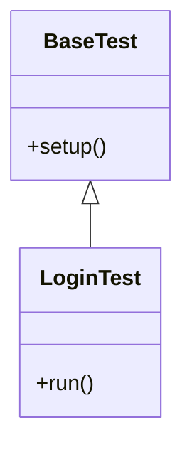
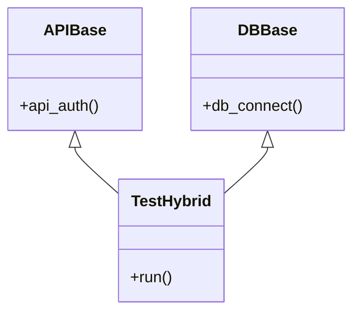
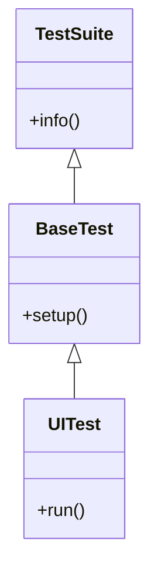
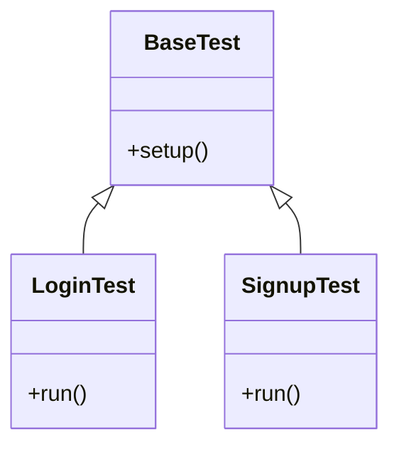
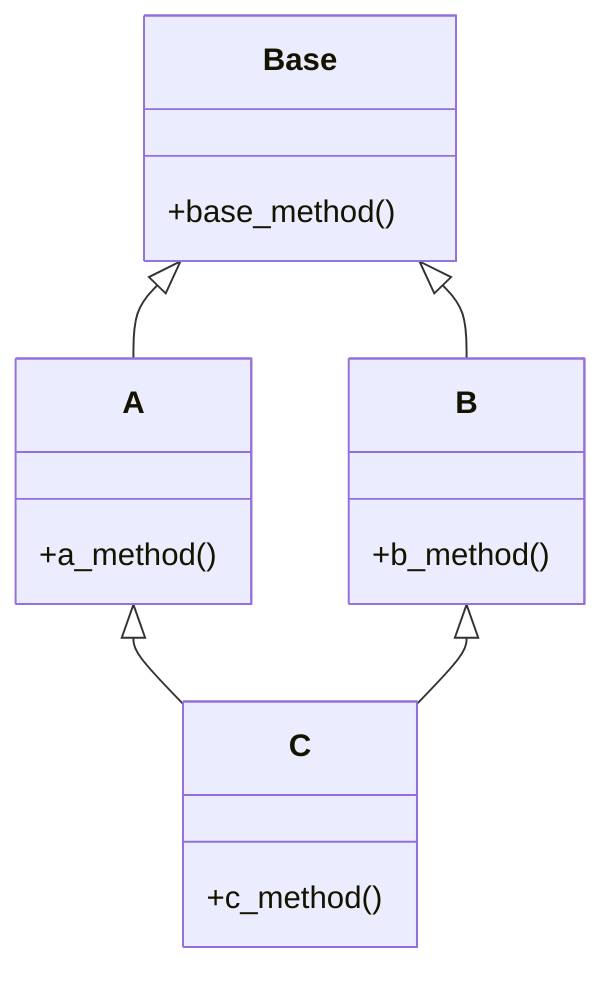

# Inheritance in Python — Complete Guide

## What is Inheritance?

Inheritance is a core OOP concept where a **child class** acquires the properties and methods of a **parent class**. It promotes **code reuse** — you write common logic once in the parent and share it across multiple children.

**Real-world analogy:** A child inherits traits (eyes, height) from parents. The child has those traits automatically without redefining them.

```text
Parent Class (Base)   ──>  Child Class (Derived)
   ↑                          ↑
  General                   Specific
```

---

## ELI5 — Inheritance for a 5th Grader 🧒

**Imagine this:** You look like your mom or dad, right? Maybe you have your dad's eyes or your mom's smile. You didn't *do* anything to get them — you just **inherited** them. You were born with them!

**Inheritance in Python is exactly the same!**

A **child class** (like you) automatically gets the things a **parent class** (like your parents) has — without writing them again.

```python
class Mom:                    # 👩 Parent
    def smile(self):
        print("😊 Smiling")

class Baby(Mom):              # 👶 Child — Baby IS-A Mom's child
    pass                      # Baby wrote NOTHING here!

baby = Baby()
baby.smile()                  # 😊 Works! Baby inherited it!
```

See? The baby didn't write the `smile` code — it got it from Mom for free. **That's inheritance!**

### The School Playground Story 🏫

Let's use a real scenario every 5th grader knows — **a school**:

```python
class Student:                    # 👨‍🏫 Parent — ALL students have this
    def __init__(self, name):
        self.name = name

    def eat_lunch(self):
        print(f"{self.name} is eating lunch 🍎")

    def go_home(self):
        print(f"{self.name} is going home 🚌")

# Now the special kids — they inherit everything from Student!
class ArtStudent(Student):        # 🎨 Child 1
    def paint(self):
        print(f"{self.name} is painting 🎨")

class MusicStudent(Student):      # 🎵 Child 2
    def play_guitar(self):
        print(f"{self.name} is playing guitar 🎸")

# Test it!
riya = ArtStudent("Riya")
riya.eat_lunch()    # ✅ From Student (inherited!)
riya.paint()        # ✅ Riya's own skill

arjun = MusicStudent("Arjun")
arjun.go_home()     # ✅ From Student (inherited!)
arjun.play_guitar() # ✅ Arjun's own skill
```

**Why is this awesome?** Riya and Arjun both eat lunch and go home — but we wrote that code **ONCE** in `Student`. No copying, no repeating! If the school changes lunch time, we change it in ONE place.

**Remember this one sentence:** *Inheritance = a child class gets the parent's superpowers for free, then adds its own.* 🦸

---

## Types of Inheritance in Python

Python supports **5 types** of inheritance:

| # | Type | Description | Files |
|---|------|-------------|-------|
| 1 | **Single** | One child inherits from one parent | `143_SI.py` |
| 2 | **Multiple** | One child inherits from multiple parents | `144_MI.py`, `145_MI_002.py` |
| 3 | **Multilevel** | Chain: Grandparent → Parent → Child | `146_ML.py` |
| 4 | **Hierarchical** | One parent, multiple children | `147_HI.py` |
| 5 | **Hybrid** | Mix of multiple + multilevel | `148_Hybrid.py` |

---

## 1. Single Inheritance

**One parent → One child**



```python
class BaseTest:
    def setup(self):
        print("Launching browser")

class LoginTest(BaseTest):   # LoginTest IS-A BaseTest
    def run(self):
        self.setup()         # Inherited method
        print("Running login test")

t = LoginTest()
t.setup()  # From parent
t.run()    # From child
```

**Real-world use:** A base page class → specific page class (LoginPage, HomePage).

---

## 2. Multiple Inheritance

**Multiple parents → One child**



```python
class APIBase:
    def api_auth(self):
        print("Authenticating via API")

class DBBase:
    def db_connect(self):
        print("Connecting to database")

class TestHybrid(APIBase, DBBase):  # Inherits from BOTH
    def run(self):
        self.api_auth()
        self.db_connect()
        print("Running test")

tc = TestHybrid()
tc.run()
```

**⚠️ Diamond Problem & MRO:** If both parents have a method with the same name, Python uses **MRO (Method Resolution Order)** — left-to-right, depth-first.

```python
class Father1:
    def money(self):
        print("Father1's money")

class Father2:
    def money(self):
        print("Father2's money")

class Child(Father2, Father1):  # Father2 checked FIRST
    pass

c = Child()
c.money()  # Output: Father2's money (leftmost parent wins)
print(Child.__mro__)  # See the resolution order
```

**Real-world use:** A test class that needs both API authentication AND database connection.

---

## 3. Multilevel Inheritance

**Grandparent → Parent → Child (chain)**



```python
class TestSuite:          # Grandparent
    def info(self):
        print("Test Suite v2.0")

class BaseTest(TestSuite):  # Parent
    def setup(self):
        print("Setting up browser")

class UITest(BaseTest):     # Child
    def run(self):
        self.info()    # From grandparent
        self.setup()   # From parent
        print("Running UI test")

test = UITest()
test.run()
```

**Real-world use:** Framework hierarchy — `TestSuite` → `BaseTest` → `LoginTest` / `SignupTest`.

---

## 4. Hierarchical Inheritance

**One parent → Multiple children**



```python
class BaseTest:
    def setup(self):
        print("Setup from BaseTest")

class LoginTest(BaseTest):
    def run(self):
        print("Running Login Test")

class SignupTest(BaseTest):
    def run(self):
        print("Running Signup Test")

LoginTest().setup()   # Shared from BaseTest
LoginTest().run()
SignupTest().setup()  # Shared from BaseTest
SignupTest().run()
```

**Real-world use:** A single `BaseTest` class providing `setup()`/`teardown()` to ALL test classes.

---

## 5. Hybrid Inheritance

**Mix of multiple + multilevel**



```python
class Base:
    def base_method(self):
        print("Base Method")

class A(Base):       # Single: A inherits Base
    def a_method(self):
        print("A Method")

class B(Base):       # Single: B inherits Base
    def b_method(self):
        print("B Method")

class C(A, B):       # Multiple: C inherits A AND B
    def c_method(self):
        print("C method")

obj = C()
obj.base_method()  # From Base (via A or B)
obj.a_method()     # From A
obj.b_method()     # From B
obj.c_method()     # Own
```

**Real-world use:** Complex framework where a test needs capabilities from multiple branches of the hierarchy.

---

## Real-World Example — Test Automation Framework

```python
class BaseTest:
    def __init__(self, browser):
        self.browser = browser

    def setup(self):
        print(f"Launching {self.browser}")

class LoginTest(BaseTest):    # Single Inheritance
    def run_test(self):
        self.setup()
        print("Running login test...")

class SignupTest(BaseTest):   # Hierarchical Inheritance
    def run_test(self):
        self.setup()
        print("Running signup test...")

t = LoginTest("Chrome")
t.run_test()

t1 = SignupTest("Firefox")
t1.run_test()
```

---

## Real-Time Use Cases of Inheritance 🎮

### 1. Test Automation (QA Framework) 🎯

This is exactly what your [149_REAL.py](149_REAL.py) does — the standard pattern used by QA engineers worldwide:

```python
class BaseTest:                          # 👨‍🏫 Parent — every test needs this
    def __init__(self, browser):
        self.browser = browser
    def setup(self):
        print(f"Launching {self.browser}")

class LoginTest(BaseTest):               # Child 1
    def run_test(self):
        self.setup()                     # Inherited!
        print("Running login test...")

class SignupTest(BaseTest):              # Child 2
    def run_test(self):
        self.setup()                     # Inherited!
        print("Running signup test...")

t = LoginTest("Chrome")    # ✅ Browser launch comes from BaseTest
t.run_test()
```

**Real-world reason:** In a QA company, you have 100 test classes. ALL of them need to launch a browser. Without inheritance, you'd copy the browser code 100 times! With inheritance, it's written once in `BaseTest`.

### 2. Video Games 🎮

```python
class Enemy:                    # Parent — all enemies share this
    def __init__(self, hp):
        self.hp = hp
    def take_damage(self, dmg):
        self.hp -= dmg
        print(f"Enemy HP: {self.hp}")

class Zombie(Enemy):            # Child 1
    def bite(self):
        print("🧟 Zombie bites!")

class Ghost(Enemy):             # Child 2
    def float(self):
        print("👻 Ghost floats through walls!")
```

All enemies take damage the same way — written once!

### 3. Online Shopping (Amazon-style) 🛒

```python
class Product:                  # Parent
    def __init__(self, name, price):
        self.name = name
        self.price = price
    def show_price(self):
        print(f"{self.name}: ₹{self.price}")

class Electronics(Product):     # Child 1
    def warranty(self):
        print(f"{self.name} has 1-year warranty")

class Clothing(Product):        # Child 2
    def size(self):
        print(f"{self.name} comes in S/M/L")
```

### 4. Animals in a Zoo 🦁

```python
class Animal:                   # Parent
    def eat(self):
        print("Eating food 🍖")
    def sleep(self):
        print("Sleeping 😴")

class Dog(Animal):              # Child
    def bark(self):
        print("Woof! 🐶")

class Cat(Animal):              # Child
    def meow(self):
        print("Meow! 🐱")
```

### 5. Payment Systems 💳

```python
class Payment:                  # Parent — all payments share this
    def __init__(self, amount):
        self.amount = amount
    def process(self):
        print(f"Processing ₹{self.amount}...")

class CreditCard(Payment):      # Child 1
    def process(self):
        super().process()
        print("  via Credit Card 💳")

class UPI(Payment):             # Child 2
    def process(self):
        super().process()
        print("  via UPI 📱")
```

### 6. Employee Management (HR System) 🏢

```python
class Employee:                 # Parent
    def __init__(self, name, salary):
        self.name = name
        self.salary = salary
    def work(self):
        print(f"{self.name} is working")

class Developer(Employee):      # Child 1
    def code(self):
        print(f"{self.name} is writing code 💻")

class Manager(Employee):        # Child 2
    def review(self):
        print(f"{self.name} is reviewing the team 📋")
```

---

## Quick Reference

```text
Inheritance Type    Syntax                          Use Case
─────────────────  ──────────────────────────────  ─────────────────────────
Single              class Child(Parent):            One specific test type
Multiple            class Child(P1, P2):            Combining API + DB
Multilevel          class C(B): class B(A):         Framework hierarchy
Hierarchical        class C1(P): class C2(P):       Shared base for all tests
Hybrid              class C(A, B): class A(P):      Complex framework needs
```

## Key Takeaways

1. **`super()`** — Call the parent's `__init__` from the child: `super().__init__()`
2. **`isinstance(obj, Class)`** — Check if an object is an instance of a class
3. **`issubclass(Child, Parent)`** — Check inheritance relationship
4. **`ClassName.__mro__`** — See the Method Resolution Order (which class's method runs first)
5. **Python follows MRO (C3 linearization)** — Left-to-right, depth-first, then parent

---

## 🏆 10 Practice Assignments (Easy → Medium → Hard)

> **How to use:** Try each one yourself first. The difficulty increases as you go. Each assignment is a real enterprise-level scenario you'd actually face at work.

### 🟢 EASY (Level 1–3)

---

#### Assignment 1: Employee Base Class (Single Inheritance)

**Scenario:** An HR system needs to manage different types of employees. All employees share common info (name, ID, salary), but different roles have different duties.

**Task:**
1. Create a parent class `Employee` with `__init__(self, name, emp_id, salary)` and a method `work()` that prints `"{name} is working"`
2. Create a child class `Developer(Employee)` with a method `code()` that prints `"{name} is writing code"`
3. Create a child class `Manager(Employee)` with a method `review()` that prints `"{name} is reviewing the team"`
4. Create one object of each and call both the inherited `work()` and their own method

**Expected output:**
```text
Alice is working
Alice is writing code
Bob is working
Bob is reviewing the team
```

---

#### Assignment 2: Vehicle Showroom (Single Inheritance)

**Scenario:** A car showroom sells different vehicle types. Every vehicle has a brand, model, and year. Cars can honk, bikes can wheelie.

**Task:**
1. Parent class `Vehicle` with `__init__(self, brand, model, year)` and `start()` printing `"{brand} {model} engine started"`
2. Child `Car(Vehicle)` with `honk()` printing `"Beep beep!"`
3. Child `Bike(Vehicle)` with `wheelie()` printing `"Doing a wheelie!"`
4. Create a `Car("Toyota", "Camry", 2024)` and a `Bike("Yamaha", "R15", 2023)`, call all methods

---

#### Assignment 3: Zoo Animals (Single Inheritance)

**Scenario:** A zoo management app tracks animals. All animals eat and sleep. Specific animals make specific sounds.

**Task:**
1. Parent `Animal` with `__init__(self, name)` and methods `eat()` → `"{name} is eating"`, `sleep()` → `"{name} is sleeping"`
2. Child `Lion(Animal)` with `roar()` → `"{name} roars loudly!"`
3. Child `Monkey(Animal)` with `climb()` → `"{name} climbs the tree!"`
4. Create `Lion("Simba")` and `Monkey("George")`, call all methods

---

### 🟡 MEDIUM (Level 4–6)

---

#### Assignment 4: Test Automation Framework (Hierarchical Inheritance)

**Scenario:** You're building a Selenium-style test framework. Every test needs to `setup()` (launch browser) and `teardown()` (close browser). Different test types run different tests.

**Task:**
1. Parent `BaseTest` with `__init__(self, browser)` storing browser, `setup()` printing `"Launching {browser} browser"`, `teardown()` printing `"Closing {browser} browser"`
2. Child `LoginTest(BaseTest)` with `run_test()` that calls `setup()`, prints `"Running login test"`, then calls `teardown()`
3. Child `SignupTest(BaseTest)` with `run_test()` that calls `setup()`, prints `"Running signup test"`, then calls `teardown()`
4. Run both tests with different browsers (`"Chrome"`, `"Firefox"`)

**Expected output:**
```text
Launching Chrome browser
Running login test
Closing Chrome browser
Launching Firefox browser
Running signup test
Closing Firefox browser
```

---

#### Assignment 5: Payment Gateway (Multiple Inheritance)

**Scenario:** An e-commerce payment system. A payment needs both **fraud checking** (from one parent) and **tax calculation** (from another parent). A `CardPayment` needs both.

**Task:**
1. Parent `FraudCheck` with `check_fraud(self, amount)` printing `"Fraud check passed for ₹{amount}"`
2. Parent `TaxCalculator` with `calculate_tax(self, amount)` printing `"Tax ₹{amount * 0.18}"`
3. Child `CardPayment(FraudCheck, TaxCalculator)` with `pay(self, amount)` that calls both parent methods and prints `"Payment of ₹{amount} completed"`
4. Create a `CardPayment` object, call `pay(5000)`

**Expected output:**
```text
Fraud check passed for ₹5000
Tax ₹900.0
Payment of ₹5000 completed
```

---

#### Assignment 6: Company Hierarchy (Multilevel Inheritance)

**Scenario:** A company has a hierarchy: **CEO** → **Manager** → **Developer**. Each level inherits from the one above and adds its own responsibility.

**Task:**
1. `CEO` class with `__init__(self, name)` and `make_decisions()` → `"{name} (CEO) makes company decisions"`
2. `Manager(CEO)` with `manage_team()` → `"{name} (Manager) manages the team"`
3. `Developer(Manager)` with `write_code()` → `"{name} (Developer) writes code"`
4. Create a `Developer("Rahul")` and call ALL THREE methods (inherited through the chain)

**Expected output:**
```text
Rahul (CEO) makes company decisions
Rahul (Manager) manages the team
Rahul (Developer) writes code
```

---

### 🔴 HARD (Level 7–10)

---

#### Assignment 7: E-Commerce Product Catalog (Hybrid Inheritance)

**Scenario:** An online store has products. Some products are **physical** (need shipping), some are **digital** (need download link). A **subscription** product is BOTH physical (ships a welcome kit) AND digital (gives download access).

**Task:**
1. `Product` base with `__init__(self, name, price)` and `show_info()` → `"{name} - ₹{price}"`
2. `PhysicalProduct(Product)` with `ship()` → `"Shipping {name} to your address"`
3. `DigitalProduct(Product)` with `download()` → `"Download link sent for {name}"`
4. `SubscriptionProduct(PhysicalProduct, DigitalProduct)` with `activate()` → `"Subscription activated for {name}"`
5. Create a `SubscriptionProduct("Netflix Premium", 499)`, call `show_info()`, `ship()`, `download()`, `activate()` — all should work!

**Hint:** This is hybrid because `SubscriptionProduct` inherits from two branches that both come from `Product`.

---

#### Assignment 8: Banking System with Access Control (Encapsulation + Inheritance)

**Scenario:** A bank needs different account types. All accounts have a **private** account number that only authorized staff can see. Savings accounts add interest; Current accounts allow overdraft.

**Task:**
1. `BankAccount` with `__init__(self, account_number, balance)` — store `__account_number` as **private**, `balance` as **public**
2. Method `show_balance()` → `"Balance: ₹{balance}"`
3. Method `show_account_number(self, is_authorized)` — only prints the number if `is_authorized == True`, else prints `"Access denied"`
4. `SavingsAccount(BankAccount)` with `add_interest()` → adds 4% to balance
5. `CurrentAccount(BankAccount)` with `overdraft()` → prints `"Overdraft allowed up to ₹50000"`
6. Test: create a savings account, deposit, add interest, show balance. Try accessing `__account_number` directly (should fail!) then via the authorized method

**Challenge:** Prove that `__account_number` is truly private — show the `AttributeError` when accessed directly.

---

#### Assignment 9: Multi-Environment Test Runner (MRO Mastery)

**Scenario:** A QA team runs tests on multiple environments. Different environments provide different capabilities. A `FullTestRunner` needs capabilities from BOTH `APITest` and `UITest`, but both define a `run()` method. You must control which one wins.

**Task:**
1. `APITest` with `run()` → `"Running API tests"` and `api_auth()` → `"API authenticated"`
2. `UITest` with `run()` → `"Running UI tests"` and `ui_setup()` → `"UI browser launched"`
3. `FullTestRunner(APITest, UITest)` — call `run()` and observe which parent wins (MRO!)
4. Then create `FullTestRunner2(UITest, APITest)` — call `run()` again and see the order change
5. Print `FullTestRunner.__mro__` and explain why the order matters

**Expected learning:** The **leftmost parent** in the class definition wins when methods conflict. This is critical in real frameworks where you must control method resolution.

---

#### Assignment 10: Complete Test Automation Framework (Capstone — All Concepts)

**Scenario:** Build a mini enterprise test framework combining EVERYTHING you learned: inheritance, encapsulation, MRO, and real-world structure.

**Requirements:**
1. `BaseTest` with:
   - `__init__(self, browser, environment)` — browser and env stored
   - `_log(self, message)` — **protected** method printing `"[LOG] {message}"`
   - `setup()` → logs `"Launching {browser} on {environment}"`
   - `teardown()` → logs `"Closing {browser}"`
2. `APITest(BaseTest)` with `run()` → logs `"Running API tests"` (calls `setup()` first)
3. `UITest(BaseTest)` with `run()` → logs `"Running UI tests"` (calls `setup()` first)
4. `FullSuite(APITest, UITest)` — hybrid: inherits both, adds `execute()` that calls `setup()`, both `run()`s via `super()`, then `teardown()`
5. Create `FullSuite("Chrome", "staging")` and run `execute()`
6. Print the MRO of `FullSuite` and explain the resolution order

**Bonus (hard):** Add a `__password` private attribute to `BaseTest` and a `login()` method that uses it. Prove it can't be accessed from `FullSuite`.

**Expected output (roughly):**
```text
[LOG] Launching Chrome on staging
[LOG] Running API tests
[LOG] Running UI tests
[LOG] Closing Chrome
```

---

## ✅ Assignment Checklist

| # | Difficulty | Concept | Status |
|---|-----------|---------|--------|
| 1 | 🟢 Easy | Single Inheritance — HR | ☐ |
| 2 | 🟢 Easy | Single Inheritance — Vehicles | ☐ |
| 3 | 🟢 Easy | Single Inheritance — Zoo | ☐ |
| 4 | 🟡 Medium | Hierarchical — Test Framework | ☐ |
| 5 | 🟡 Medium | Multiple — Payment Gateway | ☐ |
| 6 | 🟡 Medium | Multilevel — Company Hierarchy | ☐ |
| 7 | 🔴 Hard | Hybrid — E-Commerce | ☐ |
| 8 | 🔴 Hard | Encapsulation + Inheritance — Banking | ☐ |
| 9 | 🔴 Hard | MRO Mastery — Test Runner | ☐ |
| 10 | 🔴 Hard | Capstone — Full Framework | ☐ |

> 💡 **Pro tip:** After solving each one, run your code and verify the output matches the expected output shown. If it does — you've mastered that concept!